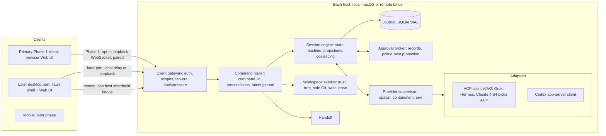

# 02 — System Architecture and Technology
> 2026-10-20 (owner): D49–D54 recorded — React retained on partial S5 evidence; journal opens atomically without following symlinks; daemon refuses network/synced data filesystems; Codex is first in P1a; tokio/clap/nix are allowed daemon dependencies; contracts remain generated with client helpers in `packages/client`.
> 2026-10-23 (owner, D66): browser-first Phase 1; opt-in loopback WebSocket and browser pairing move forward from Phase 2. Tauri, mobile and other platforms are later ports of the same React UI.

> Part of the Shardrail architecture plan. Status: **candidate, not owner-approved**. Decision IDs (D#) are explained in [12-decisions](12-decisions.md). Revised 2026-10-18 after the independent review ([15](15-independent-review.md)): planned restart (D39), Tauri IPC as relay, Claude channel label. 2026-10-18: daemon language Rust approved by the owner (D1, U13). 2026-10-18 (owner): U8 answered — React 19 + TS strict + Vite SPA + React Aria + TanStack Virtual (D3); all code is written by AI coding agents (D44). 2026-10-19 (owner): D27 approved — Rust types → `schemars` JSON Schema (committed) → TypeScript, `ts-rs` fallback, CI drift check. 2026-10-19 (owner): remaining owner questions answered in bulk (17); Hermes not in Phase 1 (D48); core spikes S1-lite, S2, S5, S9-lite authorized.

## 1. Shape

**One daemon (`shardraild`) per host, on the machine where the files and agent processes live; thin clients.** The daemon is the only writer of the journal and the only owner of provider processes. Clients never start `codex`, `claude`, `grok` or `hermes` themselves.

## 2. Components

| Component | Does | Does not |
| --- | --- | --- |
| Daemon core | hosts all components; single-instance lock on the data dir; startup/shutdown; diagnostics ring | call models |
| Client gateway | authenticates clients (asymmetric keys, mutual handshake), enforces scopes, fans out events with bounded per-client queues, resyncs on overflow | interpret provider protocols |
| Command router | `command_id` idempotency, preconditions, intent journaling (05) | provider I/O |
| Session engine | state machine (05), delta coalescing, projections, replay handling | own processes |
| Provider supervisor | spawn per topology, all-descendant containment, environment sanitization, version detection | protocol translation |
| Adapters | one protocol each; capability negotiation; normalization; refusal of unknown requests (03) | render UI, store secrets |
| Approval broker | approval records, option classes, expiry policy, host protection state (06) | judge command safety from model text |
| Workspace service | trust state, read-only tree, safe Git, scoped watchers, write lease | write files |
| Handoff | assemble and show bundles | transfer provider memory |
| Desktop shell (later port) | window, menu-bar presence, notifications, keychain, deep links (no actions), connection to daemon, SSH bridge launcher | domain logic |
| Web UI (primary Phase 1 client) | projection and input; browser pairing; client-side host federation; attention inbox | be a source of truth |

Provider processes are a trust boundary: their output is untrusted input, their environment is never logged, and one provider's environment is never passed to another.

## 3. Processes on macOS

- **Phase 1:** the user starts `shardraild` locally; its lifetime is independent of the browser tab. If all clients disconnect, the U18 grace period applies: turns get up to 10 minutes, then are cancelled (desynced processes are not killed automatically).
  *Why:* D66 makes the browser the first client, so there is no desktop shell to own or launch the daemon.
- **Later desktop port:** the shell connects to or starts the daemon; **its lifetime is the app's, not the window's.** Closing the window hides it; a menu-bar item shows running sessions and pending approvals; quitting asks whether to cancel all turns.
  *Why:* the first design stopped the daemon with the window, which cancelled agents' work whenever the user merely closed the window.
- **Later desktop port — connect first:** the shell first tries to connect to (and authenticate) an existing daemon and only spawns one if none answers. A daemon with no clients keeps running turns for at most 10 minutes, then cancels them (approvals are withdrawn, never allowed) — U18, owner-approved 2026-10-19; desynced processes are not killed by this timer (U22).
- **Later desktop port — version skew:** a new shell that finds an older daemon offers "restart daemon" and never speaks an incompatible protocol.
- **Planned restart = drain-then-upgrade (D39).** Because the macOS helper and the Linux cgroup kill provider trees when the daemon goes away, any daemon restart would otherwise cancel running turns. A daemon upgrade or version-skew restart therefore stops new turns, waits for running turns and open approvals to finish (bounded by `T_drain`), asks the user about remaining blockers, closes idle provider sessions through the protocol and only then restarts (05 §1). A shell update never restarts a protocol-compatible daemon.
- **Continuous operation without a desktop app** is a later, opt-in mode via a launch agent (`SMAppService`); ownership mode is fixed at daemon start (U6 answered 2026-10-19: not in MVP; Phase 2, E2.5).
- Agent processes are descendants of the app, so macOS privacy (TCC) prompts triggered by agents are attributed to Shardrail. Granting Shardrail Accessibility, Automation or Screen Recording voids approval protection (06).

## 4. Processes on Linux

Same daemon binary under a systemd **user** service, never root. Agents run as the checkout owner by default; a separate agent Unix user is recommended but its mechanism is not yet specified (U11, deferred to Phase 2 by the owner 2026-10-19: needs a privileged spawner that spawns, contains and kills on the daemon's behalf). Remote setup checks `loginctl enable-linger` so sessions survive logout. After a reboot, systemd restarts the daemon; turns are never continued automatically — resume is manual.

## 5. Provider process topology

Default is one provider process per session until a spike shows that sharing is safe for that provider.

| Provider | Default | Possible after spike | Basis |
| --- | --- | --- | --- |
| Codex | process per session | process per workspace (threads with per-turn `sandboxPolicy`/`cwd`) if concurrent turns and isolation hold | Codex docs (EV-03) |
| Grok | process per session | shared only for profiles S2 allows (non-zero sandbox profiles refuse leader mode) | Grok manual |
| Hermes | process per session | shared if per-session approval/toolset isolation holds | EV-06 |
| Claude | adapter process; each session spawns its own CLI | adapter shared, CLI per session | adapter design |

Escalating a cancel to process termination on a shared process requires user confirmation listing the affected sessions.

*Why per-provider:* the first rule was "process per session everywhere"; Codex's per-turn sandbox policy showed that a uniform rule multiplies memory without isolation benefit.

## 6. Client communication

- **One wire protocol** for every client and transport: schema-defined JSON messages; requests carry `command_id` and optional preconditions; the server pushes durable events with a per-host cursor and coalesced ephemeral updates; handshake carries protocol version, host id and `journal_epoch`.
- **Browser ↔ local daemon (Phase 1):** the user explicitly enables an opt-in loopback WebSocket listener. Pair the browser through the existing asymmetric, transcript-bound Ed25519 handshake; paired browser credentials default to `limited` scope (06 §4). The listener validates the request `Host` and browser `Origin`, rejects other hosts/origins, and never accepts credentials in a URL or query string. Browser key storage follows 06 §4. This is a normal browser client; it does not receive a shell-minted token.
- **Desktop ↔ local daemon (later port):** Tauri may relay frames to the Unix socket or use the loopback WebSocket, based on S5 evidence. Shell-minted tokens, the Tauri isolation pattern and keychain storage belong to this port; the WebView receives only a short-lived shell-minted token, and untrusted-rendering protections (06 §5) remain required because script injection can steal it. Tauri IPC opens no TCP port.
- **Desktop ↔ remote daemon:** the app spawns system OpenSSH as `ssh <host> shardraild bridge`, which relays stdio to the remote daemon socket. No forwarded ports, uses the user's SSH config, keys and jump hosts. The remote daemon's key is pinned end to end through the bridge.
  *Why:* the first design required the user to set up `ssh -L` forwards by hand.
- On shared multi-user Linux hosts, prefer the SSH bridge over browser loopback access.
- **Multi-host:** the client holds one connection per host and federates sessions keyed by `(host_id, session_id)` with a cursor per host. There is no daemon-to-daemon replication. The attention inbox is a client view.
- **Mobile:** decided at the start of the mobile phase (D28): candidates are a PWA through a user-managed mesh VPN or SSH, with Web Push for approval notifications, a Tauri Android shell, or a small Kotlin WebView shell.
- **Later multi-machine direction (D67):** first add the same daemon on the M1 home server and connect from the laptop/browser through the existing SSH stdio bridge. A hub/relay on Daliys's purchased server is a **candidate**, not a committed design: each daemon would make an outbound connection and browsers would connect to the hub. D69 requires hub-relayed traffic to use end-to-end AEAD between paired devices and the machine's daemon, layered on the existing transcript-bound Ed25519 handshake; the hub may store only encrypted history blobs. Key agreement details and hub-visible metadata remain open. SSH remains supported as a direct transport. See 06 §13.
- **Browser assets (D68 candidate):** recommendation is to embed the built UI assets in `shardraild` so they match the daemon version, while retaining the explicit assets-path flag as a developer override. This is not yet owner-confirmed.

## 7. Data ownership

| Data | Location | Owner |
| --- | --- | --- |
| Shardrail journal, projections, trust, queue, leases, handoff bundles | SQLite in the daemon data dir, `0600` | Shardrail |
| Agent transcripts and memory | `~/.codex`, `~/.claude`, `~/.grok`, `~/.hermes` | provider |
| Provider credentials | provider stores / OS keychain as the provider does it | provider |
| Shardrail keys | macOS keychain; Linux `0600` file (readable by the same UID — documented weakness) | Shardrail |
| Checkout and worktrees | workspace disk | user and agent |

The daemon never copies provider home directories into its database. After a crash it asks the provider (`thread/resume`, `session/resume`/`session/load`) rather than replaying from its own copy; its own history is for display when the provider is gone.

Data dirs: macOS `~/Library/Application Support/Shardrail/`; Linux `$XDG_DATA_HOME/shardrail/`. Nothing is written into provider directories except what providers write themselves.

**Install and logs (D68, owner-agreed 2026-10-24):** install the macOS desktop app in a normal app location (for example `/Applications/Shardrail.app`) and the daemon in a standard bin/Homebrew prefix; data stays under `~/Library/Application Support/Shardrail/`, logs under `~/Library/Logs/Shardrail/`. Linux data uses XDG; the log destination remains undecided pending owner direction. The current browser-first daemon has no file-log setup and only accepts browser assets through `--browser-assets-dir`; implementation follow-up is in 10 §4.

## 8. Technology choices

| Area | Choice | Why | Rejected alternatives |
| --- | --- | --- | --- |
| Daemon language (D1) | **Rust — owner-approved 2026-10-18 (U13)**; Rust types are the contract source and a committed JSON Schema (D27) keeps data language-neutral | same language as the Tauri 2 shell; no GC pauses; compile-time safety for approval/state invariants; official ACP crate; single static binary. Raw speed was not the deciding factor (the daemon is I/O-bound) | **Go** and **C# / .NET NativeAOT** (community ACP libraries only, EV-30) were considered and rejected by the owner. **TypeScript daemon**: makes Node mandatory for every session. **Go + Rust split**: two systems languages for no isolation gain. |
| Desktop shell (D2) | **Tauri 2 + system WKWebView**; shell holds no domain logic | one UI for desktop/browser/mobile; no bundled Chromium | Electron (bundled Chromium per app contradicts low overhead); three native UIs (too costly solo); GPU-native Rust UI such as GPUI/Slint (no browser/mobile, weaker accessibility); Dioxus (weaker accessible-UI ecosystem). W4-m retained Tauri; Swift/AppKit is a reference spike only. Tauri 3 prereleases not used. |
| Frontend (D3) | **React 19 + TypeScript strict + Vite (plain SPA) + React Aria Components + TanStack Virtual — owner-approved 2026-10-18 (U8), retained 2026-10-23 (D49)**; one renderer, no second state store; client holds a bounded projection; TS types generated from Rust via JSON Schema (D27) | daemon journal is the source of truth; best AI-codegen reliability and accessible primitives (D44, 16); W4-m's similar latency growth in Tauri and Swift points to delivery, not framework | Redux/MobX-style stores; Next.js/SSR/RSC; SolidJS, Vue, Lit, Preact, Rust/WASM UIs (Leptos, Dioxus, Yew) and non-web native toolkits (16). Optimize daemon-to-UI delivery before reopening framework choice. |
| Storage (D5) | **SQLite WAL, one file per daemon, single writer**, embedded SQLite | one owner per host; crash behavior well understood | Postgres; CRDTs; JSONL-only (poor random access); "provider is the only truth" (breaks history when the provider is gone). FTS only if measured necessary. |
| Encoding | JSON; binary (CBOR/MessagePack) only if measurement shows serialization in the latency path | simplicity, debuggability | gRPC / gRPC-web (proxies in browsers, heavier) |

Dependencies at runtime on the user's machine (not build dependencies): provider binaries, system WebView, OpenSSH (remote), Node (Claude adapter and possibly the Codex npm wrapper). Python is needed only if Hermes is added in a later phase; Hermes is not a Phase 1 runtime dependency (D48).
