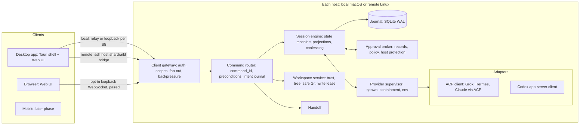

# 02 — System Architecture and Technology

> Part of the Shardrail architecture plan. Status: **candidate, not owner-approved**. Decision IDs (D#) are explained in [12-decisions](12-decisions.md).

## 1. Shape

**One daemon (`shardraild`) per host, on the machine where the files and agent processes live; thin clients.** The daemon is the only writer of the journal and the only owner of provider processes. Clients never start `codex`, `claude`, `grok` or `hermes` themselves.

## 2. Components

| Component | Does | Does not |
| --- | --- | --- |
| Daemon core | hosts all components; single-instance lock on the data dir; startup/shutdown; diagnostics ring | call models |
| Client gateway | authenticates clients (asymmetric keys, mutual handshake), enforces scopes, fans out events with bounded per-client queues, resyncs on overflow | interpret provider protocols |
| Command router | `command_id` idempotency, preconditions, intent journaling (05) | provider I/O |
| Session engine | state machine (05), delta coalescing, projections, replay handling | own processes |
| Provider supervisor | spawn per topology, all-descendant containment, environment sanitization, version detection | protocol translation |
| Adapters | one protocol each; capability negotiation; normalization; refusal of unknown requests (03) | render UI, store secrets |
| Approval broker | approval records, option classes, expiry policy, host protection state (06) | judge command safety from model text |
| Workspace service | trust state, read-only tree, safe Git, scoped watchers, write lease | write files |
| Handoff | assemble and show bundles | transfer provider memory |
| Desktop shell | window, menu-bar presence, notifications, keychain, deep links (no actions), connection to daemon, SSH bridge launcher | domain logic |
| Web UI | projection and input; client-side host federation; attention inbox | be a source of truth |

Provider processes are a trust boundary: their output is untrusted input, their environment is never logged, and one provider's environment is never passed to another.

## 3. Processes on macOS

- The daemon is a separate process started by the app; **its lifetime is the app's, not the window's.** Closing the window hides it; a menu-bar item shows running sessions and pending approvals; quitting asks whether to cancel all turns.
  *Why:* the first design stopped the daemon with the window, which cancelled agents' work whenever the user merely closed the window.
- **Connect first:** the shell first tries to connect to (and authenticate) an existing daemon and only spawns one if none answers. A daemon whose shell crashed ("orphan daemon") keeps running turns for at most 10 minutes without any client, then cancels them (approvals are withdrawn, never allowed) — owner question U18.
- **Version skew:** a new shell that finds an older daemon offers "restart daemon" and never speaks an incompatible protocol.
- **Continuous operation with the app closed** is a later, opt-in mode via a launch agent (`SMAppService`); ownership mode is fixed at daemon start (owner question U6).
- Agent processes are descendants of the app, so macOS privacy (TCC) prompts triggered by agents are attributed to Shardrail. Granting Shardrail Accessibility, Automation or Screen Recording voids approval protection (06).

## 4. Processes on Linux

Same daemon binary under a systemd **user** service, never root. Agents run as the checkout owner by default; a separate agent Unix user is recommended but its mechanism is not yet specified (U11: needs a privileged spawner that spawns, contains and kills on the daemon's behalf). Remote setup checks `loginctl enable-linger` so sessions survive logout. After a reboot, systemd restarts the daemon; turns are never continued automatically — resume is manual.

## 5. Provider process topology

Default is one provider process per session until a spike shows that sharing is safe for that provider.

| Provider | Default | Possible after spike | Basis |
| --- | --- | --- | --- |
| Codex | process per session | process per workspace (threads with per-turn `sandboxPolicy`/`cwd`) if concurrent turns and isolation hold | Codex docs (EV-03) |
| Grok | process per session | shared only for profiles S2 allows (non-zero sandbox profiles refuse leader mode) | Grok manual |
| Hermes | process per session | shared if per-session approval/toolset isolation holds | EV-06 |
| Claude | adapter process; each session spawns its own CLI | adapter shared, CLI per session | adapter design |

Escalating a cancel to process termination on a shared process requires user confirmation listing the affected sessions.

*Why per-provider:* the first rule was "process per session everywhere"; Codex's per-turn sandbox policy showed that a uniform rule multiplies memory without isolation benefit.

## 6. Client communication

- **One wire protocol** for every client and transport: schema-defined JSON messages; requests carry `command_id` and optional preconditions; the server pushes durable events with a per-host cursor and coalesced ephemeral updates; handshake carries protocol version, host id and `journal_epoch`.
- **Desktop ↔ local daemon:** WebView JavaScript cannot open Unix sockets, so either the shell relays frames to the socket without parsing them, or the WebView uses the loopback WebSocket. Spike S5 chooses on latency, code size and credential exposure. In both cases the WebView receives only a short-lived session token minted by the shell, and the untrusted-rendering policy (06 §5) is a prerequisite, because script injection into the WebView equals token theft.
- **Desktop ↔ remote daemon:** the app spawns system OpenSSH as `ssh <host> shardraild bridge`, which relays stdio to the remote daemon socket. No forwarded ports, uses the user's SSH config, keys and jump hosts. The remote daemon's key is pinned end to end through the bridge.
  *Why:* the first design required the user to set up `ssh -L` forwards by hand.
- **Browser:** opt-in loopback WebSocket listener with paired credentials, Origin and Host checks, no credential in URLs. On shared multi-user Linux hosts prefer the bridge.
- **Multi-host:** the client holds one connection per host and federates sessions keyed by `(host_id, session_id)` with a cursor per host. There is no daemon-to-daemon replication. The attention inbox is a client view.
- **Mobile:** decided at the start of the mobile phase (D28): candidates are a PWA through a user-managed mesh VPN or SSH, with Web Push for approval notifications, a Tauri Android shell, or a small Kotlin WebView shell.

## 7. Data ownership

| Data | Location | Owner |
| --- | --- | --- |
| Shardrail journal, projections, trust, queue, leases, handoff bundles | SQLite in the daemon data dir, `0600` | Shardrail |
| Agent transcripts and memory | `~/.codex`, `~/.claude`, `~/.grok`, `~/.hermes` | provider |
| Provider credentials | provider stores / OS keychain as the provider does it | provider |
| Shardrail keys | macOS keychain; Linux `0600` file (readable by the same UID — documented weakness) | Shardrail |
| Checkout and worktrees | workspace disk | user and agent |

The daemon never copies provider home directories into its database. After a crash it asks the provider (`thread/resume`, `session/resume`/`session/load`) rather than replaying from its own copy; its own history is for display when the provider is gone.

Data dirs: macOS `~/Library/Application Support/Shardrail/`; Linux `$XDG_DATA_HOME/shardrail/`. Nothing is written into provider directories except what providers write themselves.

## 8. Technology choices

| Area | Choice | Why | Rejected alternatives |
| --- | --- | --- | --- |
| Daemon language (D1) | **Rust**, with schema-first contracts (D27) so a Go rewrite stays possible | official ACP crate; strong enums for event/state modelling; no GC; single static binary | **Go + thin Swift WKWebView shell**: equally viable at Shardrail's event rates and equally memory-safe; faster iteration — the owner's own proficiency is the deciding input (U13). **TypeScript daemon**: makes Node mandatory for every session. **Go + Rust split**: two systems languages for no isolation gain. |
| Desktop shell (D2) | **Tauri 2 + system WKWebView**; shell holds no domain logic | one UI for desktop/browser/mobile; no bundled Chromium | Electron (bundled Chromium per app contradicts low overhead); three native UIs (too costly solo); GPU-native Rust UI such as GPUI/Slint (no browser/mobile, weaker accessibility); Dioxus (weaker accessible-UI ecosystem). Fallback if S5 fails: thin Swift WKWebView shell. Tauri 3 prereleases not used. |
| Frontend (D3) | **TypeScript, one renderer, no second state store**; client holds a bounded projection | daemon journal is the source of truth | Redux/MobX-style stores. Framework (SolidJS vs React) chosen in S5 against latency **and** the cost of meeting WCAG with available accessible primitives (U8). |
| Storage (D5) | **SQLite WAL, one file per daemon, single writer**, embedded SQLite | one owner per host; crash behavior well understood | Postgres; CRDTs; JSONL-only (poor random access); "provider is the only truth" (breaks history when the provider is gone). FTS only if measured necessary. |
| Encoding | JSON; binary (CBOR/MessagePack) only if measurement shows serialization in the latency path | simplicity, debuggability | gRPC / gRPC-web (proxies in browsers, heavier) |

Dependencies at runtime on the user's machine (not build dependencies): provider binaries, system WebView, OpenSSH (remote), Python (Hermes), Node (Claude adapter and possibly the Codex npm wrapper).
