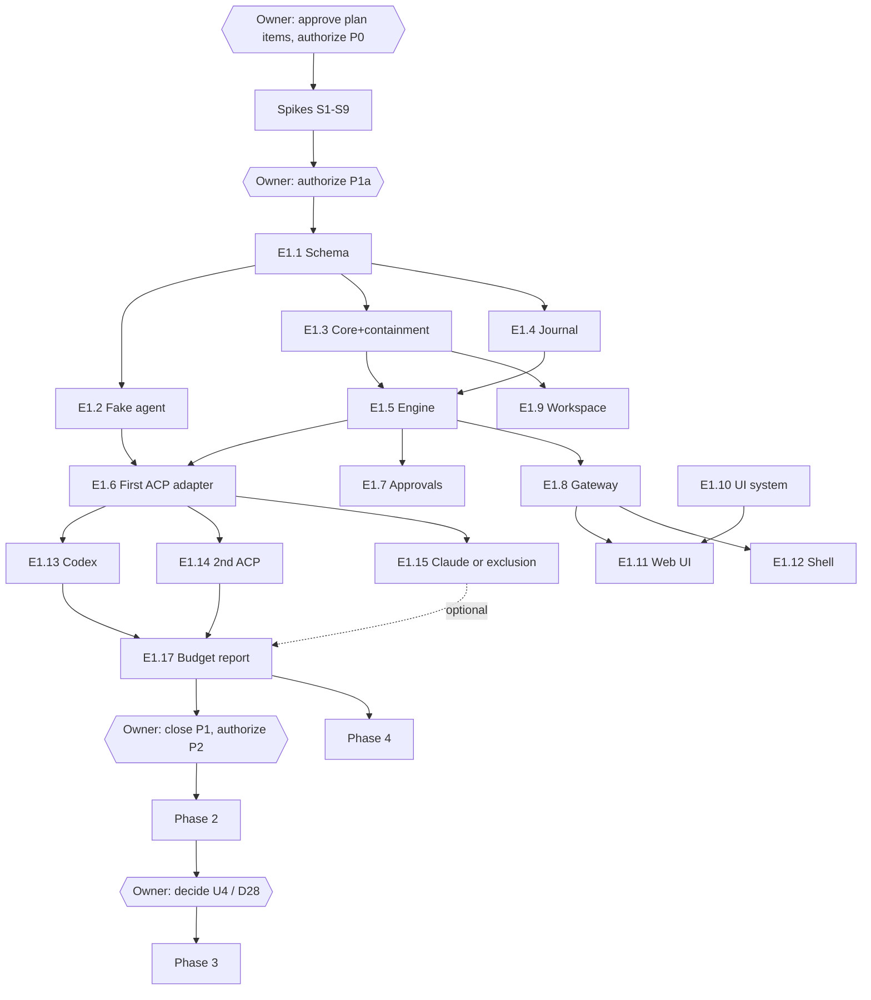

# 10 — Roadmap and Backlog

> Part of the Shardrail architecture plan. Status: **candidate, not authorized**. No phase, epic or task may start until the owner approves the relevant decisions and authorizes the phase. Complexity classes S < M < L < XL; no calendar estimates.

## 1. Phases

Phases are sequential; the next starts only when the current gate is closed or consciously narrowed by a recorded decision.

| Phase | Objective | Content | Gate | Risk | Size |
| --- | --- | --- | --- | --- | --- |
| **P0 Feasibility** | replace assumptions with evidence | spikes S1–S9 (§2); disposable code only; live models only here, on a test repo without real secrets | each spike's "done when" | medium | M |
| **P1a Foundation** | vertical slice, one local client | journal schema; one fake ACP agent; daemon core + supervisor + macOS containment helper; journal; session engine with the full state machine; approvals + host protection + trust; one local desktop connection (`full` scope only, no browser listener); safe Git view; write lease; minimal UI (inbox, session view, palette); **one** ACP provider (prefer a sandboxed one, e.g. Grok, per S2/S7) | F2–F10, F12, F13, F18–F22 on fixtures; containment fixture with a detached tool; Git worker `execve` tripwire; B1, B4, B7 | high | XL |
| **P1b Codex** | Codex adapter | app-server adapter; fake app-server agent (incl. permission grants, elicitation, user input); compatibility policy; schema reference | Codex fixtures + live smoke; schema drift test | medium | L |
| **P1c Second ACP provider** | reuse ACP client | mapping, pinning, toolset display | fixtures + smoke | low | M |
| **P1d Claude** | Claude per S4, **only if U9 is resolved**; otherwise a recorded exclusion | channel, pinning, branding | fixtures + smoke, or exclusion record | high (non-technical) | M–L |
| **P1 close** | ship the local product | manual handoff MVP (if U19 = yes); budget report | F1–F13 on fixtures; one live smoke per included provider; B1–B7, B9, B11, B13, B14; B8 once; Claude included **or** formally excluded; no open severity-1 risk | — | M |
| **P2 Remote** | Linux and continuous operation | systemd user service, cgroup containment, linger check; SSH stdio bridge; host management; client federation and cross-host inbox; paired `limited` browser clients with asymmetric keys and mutual handshake; read-through external history (F15); optional macOS launch agent (U6); optional separate agent user (U11, once specified); macOS integrity MAC for re-establishing protection | SSH drop does not kill turns; reboot does not continue turns; B1 on Linux; no network listener (`ss` check); 72 h soak | medium | L |
| **P3 Mobile** | observe, approve, instruct from a phone | per D28 decision at phase entry | stolen-phone revocation; approval delivered ≤ 1 s after tap with a live link (model latency excluded); notification path verified; scope enforcement | high | L |
| **P4 Handoff and worktrees** | explicit task transfer | full Task model, bundle preview, provider fork as a separate command | F11; denylisted secret never in a bundle; UI never shows a diff for the wrong cwd | low | M |

**Stop conditions.** If neither the Claude ACP adapter nor a direct SDK supervisor provides two-way approval, Claude stays "observation via stream-json without approval guarantees" and is excluded from Phase 1 — the product is more honest with three controllable agents than with a fourth that cannot be safely denied. Likewise if U9 forbids subscription login and API-key-only is rejected. Other adapters are unaffected.

*Why Phase 1 is sliced:* one developer cannot close a gate containing a daemon, journal, shell, UI, four adapters over three protocols, approvals, trust and recovery at once; Claude's legal question must not block the rest.

## 2. Phase 0 spikes

Each spike takes days, not weeks, and produces a written note.

| ID | Questions | Done when |
| --- | --- | --- |
| S1 Codex | separate `codex app-server` over stdio: thread start, turn, approvals, kill, resume; JSON Schema from the pinned CLI; does it lock `~/.codex` or the control socket shared with an open TUI; concurrent turns across threads in one process; approval wait limit (hold 10 min); whether pending approvals clear at turn end; delta rates; escalation request fields (which are boundary-breaking); whether project `.codex/rules` change approvals; `-c` overrides for pinning; background terminals after turn end and after daemon kill; behavior on refused unknown requests | note on wire events; `thread/shellCommand` stays forbidden in UI; decision on running beside the user's TUI; topology decision |
| S2 Grok | one `grok agent stdio`, two sessions, different sandboxes; does `auto` still reach `session/request_permission`; `session/resume` support; reject-option presence; `tool_call_update` after allow/deny | process-per-session vs list of shareable profiles; acknowledgement rule |
| S3 Hermes | prompt, deny by timeout, resume after restart; can `session/load` open a CLI-created session; replay volume; sandboxing; approval-config pinning; effective toolset | `load_foreign_session` yes/no; acknowledgement rule |
| S4 Claude | ACP adapter vs direct SDK: approval, cancel, resume, start in an untrusted folder; passing `settingSources: []`, disabling auto memory (`CLAUDE_CODE_DISABLE_AUTO_MEMORY=1` candidate) and connectors; pinning permission mode in all trust states; `.claude/settings*.json` protection under its sandbox; API-key auth path; **plus the owner's terms answer (U9), which does not gate other work** | one Claude channel chosen (or exclusion) |
| S5 UI | transcript mock in Tauri WKWebView: B3 (whole process tree), B4, B5, 5 000 and 50 000 events; full pipeline (coalescing, incremental Markdown, virtualization); relay vs loopback latency, code size, token delivery; same mock in a bare Swift WKWebView if Tauri fails | D2/D3 confirmed or Swift fallback; transport chosen; framework chosen |
| S6 TUI attach | negative test: no adapter can honestly take over an open interactive TUI | stays Unsupported, or a narrow official attach appears |
| S7 Protection | per provider × sandbox profile: writes to Shardrail data dir, binaries, provider install trees and approval configs; socket bind/connect; reads of identity material; LaunchAgents, rc files, `~/.ssh/config`, app bundle, WebKit storage; `SSH_AUTH_SOCK` reachability; TCC attribution of descendants; keychain prompts; code-signing peer check via audit token | outcome table feeding the U21 decision rule |
| S8 Safe Git | malicious-repo fixtures: `core.fsmonitor`, `filter.*.clean/process`, `diff.*.textconv`, `diff.external`, `core.hooksPath`, `core.sshCommand`, pager/editor/credential helpers, `include`/`includeIf`, `config.worktree`, `GIT_*` env, upward discovery, out-of-workspace gitdir/`core.worktree`, symlink/hardlink escapes, LFS repo, agent rewriting `.git/config` mid-session; gix status/diff coverage with all permissions off; exec-denied worker with `execve` tripwire | library choice and worker design confirmed; B16 |
| S9 Containment | Linux: per-provider cgroup via systemd user scope/delegation, `cgroup.kill`, `KillMode` × `Restart=`, linger, pidfds. macOS: helper descendant-tracking accuracy with detaching tools (`setsid`, `nohup`, dev servers) | containment guarantees and residuals documented per OS |

## 3. Epics

| ID | Phase | Objective | Modules | Depends on | Acceptance outcome |
| --- | --- | --- | --- | --- | --- |
| E0.1–E0.9 | P0 | spikes S1–S9 | — | owner authorization | spike notes |
| E1.1 | P1a | journal event schema (codegen to Rust/TS); hand-written wire types until a second client type | M02 | P0 | reviewed schemas |
| E1.2 | P1a | fake ACP agent with scripted scenarios (normal turn, crash mid-tool, detached tool, replay on load, parallel approvals, missing reject option, unknown request) | M18 | E1.1 | runs in CI |
| E1.3 | P1a | daemon core, supervisor, macOS containment helper, spawn intent, identity records | M01, M05 | E1.1, S9 | lifecycle + containment fixtures |
| E1.4 | P1a | journal store: WAL, epoch, versioning, purge, salvage | M04 | E1.1 | F9, F17, B7 |
| E1.5 | P1a | session engine: state machine (all four cell kinds tested), tiers, projections, commands | M03 | E1.3, E1.4 | conformance suite; F12, F18 |
| E1.6 | P1a | ACP adapter for the first provider | M06 | E1.2, E1.5 | fixtures + live smoke |
| E1.7 | P1a | approval broker, option classes, host protection state, trust | M09 | E1.5, S7 | F5, F13, F21, F22; B14 |
| E1.8 | P1a | gateway + local desktop connection (`full` scope, peer identity admission, bounded queues) | M10 | E1.1, E1.5, S5 | B12 |
| E1.9 | P1a | workspace service: safe Git worker, scoped watchers, write lease | M11 | S8, E1.3 | F8, F19, B16 |
| E1.10 | P1a | UI system and rendering pipeline | M15 | S5 | B4, B5, N11 |
| E1.11 | P1a | web UI: inbox, session view, palette | M14 | E1.8, E1.10 | F3–F5, F14 (local) |
| E1.12 | P1a | desktop shell: window, menu bar, notifications, keychain, connect-first, version skew | M13 | E1.8 | B3, B6 |
| E1.13 | P1b | Codex adapter + fake app-server | M07 | E1.6, S1 | Codex fixtures + smoke |
| E1.14 | P1c | second ACP provider | M06 | E1.6 | fixtures + smoke |
| E1.15 | P1d | Claude channel or recorded exclusion | M08 | E1.6, S4, U9 | smoke or exclusion record |
| E1.16 | P1 close | manual handoff MVP (U19) | M12 | E1.6 | edited bundle → first prompt |
| E1.17 | P1 close | budget and soak report | M18 | all P1 | stored traces |
| E2.1 | P2 | Linux service, cgroups, linger, `bridge` | M16, M05 | P1 | P2 gate |
| E2.2 | P2 | host management, federation, cross-host inbox | M13, M14 | E2.1 | F14, F16 |
| E2.3 | P2 | paired `limited` clients, asymmetric keys, mutual handshake, browser listener | M10 | P1 | scope tests |
| E2.4 | P2 | read-through external history | M06, M14 | P1 | F15 |
| E2.5 | P2 | optional macOS launch agent | M01, M13 | P1, U6 | opt-in mode |
| E2.6 | P2 | macOS integrity MAC for re-establishing protection | M09, M04 | P1 | rollback test |
| E2.7 | P2 | 72 h soak | M18 | E2.1 | B8 extended |
| E3.1 / E3.2 | P3 | mobile decision (D28) / mobile client | M17 | P2, U4 | P3 gate |
| E4.1 / E4.2 | P4 | Task model + bundle / provider fork and worktree clarity | M12, M06, M11 | P1 | F11 |

## 4. Candidate tasks (clear enough to describe; all unauthorized)

| ID | Epic | Task | Verifiable outcome |
| --- | --- | --- | --- |
| T0.1 | E0.1 | Write the S1 protocol plan (questions, observations, safety limits) | reviewed plan |
| T0.4 | E0.4 | Obtain the policy/legal answer for U9 (owner action; can start now) | recorded decision |
| T0.5 | E0.5 | Define the S5 measurement protocol (process-tree footprint, clocks, workloads) | reviewed protocol |
| T0.7 | E0.6 | Define the S7 matrix (provider × profile × access type) | reviewed matrix |
| T0.8 | E0.7 | Desk comparison of Git library coverage vs needs | comparison note |
| T1.1 | E1.1 | Draft durable-event schema v0 with `schema_version` and `journal_epoch` | schema + review |
| T1.2 | E1.2 | Fake ACP agent scenarios (list in E1.2) | CI-runnable |
| T1.3 | E1.3 | Kill-daemon fixture with a detached tool: helper terminates descendants; restart shows survivors as `orphan_alive` | test passes |
| T1.4 | E1.4 | Write path with batching + kill -9 between commits; purge forensic check | F9, F17 |
| T1.5 | E1.5 | State-machine conformance tests over every cell kind | suite green |
| T1.6 | E1.5 | Command router: `command_id`, preconditions, `delivery unknown` | crash/retry tests |
| T1.7 | E1.7 | Approval CAS, expiry mapping, re-confirmation, crash between response and acknowledgement → "outcome not confirmed" | F5, F21 |
| T1.8 | E1.8 | Per-client queue bound + resync with a stalled client | ≤ B12 |
| T1.9 | E1.9 | Git worker `execve` tripwire on the S8 fixture set | CI fails on exec |
| T1.10 | E1.10 | Rendering fixtures: bidi/zero-width command, remote image in Markdown | N11 |

## 5. Dependencies

- **Critical path:** G0 → S5, S7, S8, S9 → E1.1 → E1.4 → E1.5 → E1.6 → E1.13 → E1.17 → G2. Claude is off the critical path.
- **Parallel with isolation:** spikes are independent (S7 needs the P1a providers set up); after E1.1, fake agent, core, journal and UI system touch disjoint modules; adapters E1.13–E1.15 run in parallel only after the adapter framework is stable and must not change it concurrently.
- **Bottlenecks:** the journal schema (everything depends on it) and the session engine (integration hub).
- **High-risk prerequisites:** S7 (protection claim), S5 (WebView footprint), S9 (macOS containment), U9 (Claude terms), S1 (Codex schema stability).
