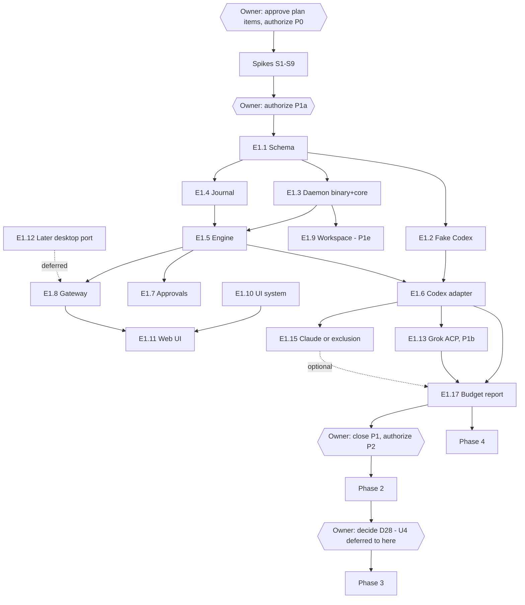

# 10 — Roadmap and Backlog
> 2026-10-20 (owner): D49–D54 recorded — React retained on partial S5 evidence; journal opens atomically without following symlinks; daemon refuses network/synced data filesystems; Codex is first in P1a; tokio/clap/nix are allowed daemon dependencies; contracts remain generated with client helpers in `packages/client`.
> 2026-10-23 (owner, D66): browser is the Phase 1 client; W5-a listener/pairing precedes S1-lite; Tauri shell work moves to a later desktop port.

> Part of the Shardrail architecture plan. Status: **candidate, not authorized**. No phase, epic or task may start until the owner approves the relevant decisions and authorizes the phase. Complexity classes S < M < L < XL; no calendar estimates. 2026-10-18 (owner): U8 answered — React 19 + TS strict + Vite SPA + React Aria + TanStack Virtual (D3); all code is written by AI coding agents (D44); S5 gains the React streaming prototype; T0.9 and T1.16 added. 2026-10-19 (owner): D27 approved — Rust types → `schemars` JSON Schema (committed) → TypeScript, `ts-rs` fallback, CI drift check. E1.1 aligned. 2026-10-19 (owner): U9/U25 answered — internal-use scope (D45); Claude via Agent SDK / `claude-agent-acp` with the user's own API key; Codex app-server with the user's own login; reopen trigger R46. Terms gate removed from P1d/E1.15; phases otherwise unchanged. 2026-10-19 (owner): single-user scope (D46) — Daliys is the only user on his own machines until the product fully works; distribution items deferred to 09 §5 (trigger R47). Distribution items are not on the critical path. 2026-10-19 (owner): U21 answered — v1 never shows a 'protected' status; each session shows a verification checklist (D47); S7 gates any future 'protected' status, which needs a separate decision. 2026-10-19 (owner): remaining owner questions answered in bulk (17); Hermes not in Phase 1 (D48); core spikes S1-lite, S2, S5, S9-lite authorized. 2026-10-19 (owner): spike rules — code in gitignored `spikes/<id>/`, notes committed in `planning/spikes/<id>.md`.
> Revised 2026-10-18 after the independent review ([15](15-independent-review.md)): P1a slimmed to a first useful slice and a new P1e hardening phase (D40); initial provider choice was deferred to spikes, then Codex was selected first by the owner (D52); core spike set reduced to four. 2026-10-18: daemon language decided by the owner (Rust, D1), so no language prototype precedes P0/P1a.

## 1. Phases

Phases are sequential; the next starts only when the current gate is closed or consciously narrowed by a recorded decision.

| Phase | Objective | Content | Gate | Risk | Size |
| --- | --- | --- | --- | --- | --- |
| **P0 Feasibility** | replace assumptions with evidence | **W5-a browser listener + pairing**, then core spikes S1-lite, S2, S5, S9-lite (authorized 2026-10-19); S5 B3/B5 and W4-m B4 evidence recorded; both Tauri and Swift miss B4, D49 retains React; B4 is known performance debt and deferred (2026-10-23); physical-input follow-up remains useful; S4, S6, S7, S8 run before the phase that needs them (§2), not yet authorized; disposable code only; live models only here, on a test repo without real secrets | W5-a security/browser criteria and each core spike's "done when"; B4 target miss recorded | medium | M |
| **P1a First useful slice** (D40, D66) | see a real agent stream and answer its approvals safely in a normal browser on the local machine | journal schema (WAL + epoch; no purge/salvage yet); fake Codex app-server; daemon binary and core + supervisor with process-group containment and a descendant snapshot (no macOS helper yet); session engine: process/link/turn, approvals, queue (05 §5a), lifecycle (05 §9), journal-unavailable fail-closed (05 §10); approvals `once`/`deny` with write-ahead (D34) and deny-on-expiry; **diffs and files only from the Codex provider protocol** (`turn/diff/updated` / `fileChange`) — no own Git; trust states with `unknown` default; permanent host banner "approvals not protected" (no aggregate status); per-session verification checklist with runtime items (sandbox applied, bypass modes off, routing pinned, config hashes, containment) — S7-dependent items shown `not verified` (06 §3b, D47); React Web UI in a normal browser; opt-in loopback WebSocket listener, paired Ed25519 credentials, Host/Origin checks and limited-by-default scope; full-scope browser pairing only through an explicit local daemon authorization; Codex app-server is the first real provider after S1-lite (D52). Tauri shell work (token minting, WebView isolation, keychain) is deferred to the desktop port | F2–F7, F9, F10, F12, F13, F18, F21, F23, F24 on fixtures; headless Playwright + daemon/browser security cases; one live smoke; B7 (B4 miss remains recorded deferred debt) | medium-high | L |
| **P1b Second protocol** | add Grok after Codex | Grok ACP mapping and fake ACP agent; sandbox confirmation; compatibility policy by protocol fingerprint | fixtures + live smoke | medium | L |
| **P1d Claude** | Claude per S4 with the user's own API key (D29, D45); a recorded exclusion only if S4 finds no two-way approval channel | channel, pinning, branding | fixtures + smoke, or exclusion record | medium (technical, S4) | M–L |
| **P1e Hardening** (D40) | verify the safety boundaries item by item | host protection state + S7 outcome table feeding the checklist's S7-dependent items (D47); no aggregate "protected" status; write lease (D31); safe Git view with exec-denied worker (S8, D23); macOS containment helper (D43, S9); code-signing peer admission against Daliys's own local/self-signed identity (06 §4, D46); drain-then-upgrade (D39); purge and salvage (04 §6) | F8, F11 (U19 = yes), F17, F19, F20, F22, F25; containment fixture with a detached tool; Git worker `execve` tripwire; B1, B3 | high | L |
| **P1 close** | verify and stabilize the local product for the owner's daily use (D46) | manual handoff MVP (U19 = yes, reviewed bundle); budget report; B4 remains deferred debt | F1–F13 on fixtures; one live smoke per included provider; B1–B3, B5–B7, B9, B11, B13, B14; B8 once; Claude included **or** formally excluded; no open severity-1 risk | — | M |
| **Post-P1 candidate: Hermes** (D48) | consider Hermes only if the owner later wants it or its approval/sandbox limits change | reuse ACP client; mapping, pinning, toolset display, permanent "file edits without approval" indicator | separate future phase decision | low | M |
| **P2 Remote** | Linux and continuous operation | systemd user service, cgroup containment, linger check; SSH stdio bridge; host management; client federation and cross-host inbox; remote limited clients via the bridge; read-through external history (F15); optional macOS launch agent (U6); optional separate agent user (U11, once specified); macOS integrity MAC for re-establishing protection | SSH drop does not kill turns; reboot does not continue turns; B1 on Linux; no non-loopback listener (`ss` check); 72 h soak | medium | L |
| **P3 Mobile** | observe, approve, instruct from a phone | per D28 decision at phase entry | stolen-phone revocation; approval delivered ≤ 1 s after tap with a live link (model latency excluded); notification path verified; scope enforcement | high | L |
| **P4 Handoff and worktrees** | explicit task transfer | full Task model, bundle preview, provider fork as a separate command | F11; denylisted secret never in a bundle; UI never shows a diff for the wrong cwd | low | M |

**Stop conditions.** If neither the Claude ACP adapter nor a direct SDK supervisor provides two-way approval, Claude stays "observation via stream-json without approval guarantees" and is excluded from Phase 1 — the product is more honest with three controllable agents than with a fourth that cannot be safely denied. Other adapters are unaffected.

*Why Phase 1 is sliced:* one developer cannot close a gate containing a daemon, journal, shell, UI, four adapters over three protocols, approvals, trust and recovery at once; Claude's legal question must not block the rest.

*Why P1a was slimmed again (2026-10-18, 15 C4):* the earlier P1a held twelve epics, six of them high-risk (full host protection, code-signing admission, macOS helper, exec-denied Git worker, write lease, full shell). Taking diffs from the provider protocol removes safe Git from the first slice entirely; P1a keeps the honest "approvals not protected" host banner and a per-session checklist, while P1e fills the S7-dependent checklist items without an aggregate status (D47). Codex app-server is first and Grok ACP follows (D52).

## 2. Phase 0 spikes

Each spike takes days, not weeks, and produces a written note. **Core set before P1a:** S1-lite (Codex: thread/turn/approval/interrupt, `approvalsReviewer` pinning, no experimental API), S2, S5a UI measurements, S9-lite (macOS sentinel-fd tracking only). The S5b B4 measurement and target miss are recorded evidence, not a P1a or P1-close gate; delivery-path work is deferred (D49). The rest run before the phase that needs them: S4 before P1d, S7/S8/full S9 before P1e, S6 any time; S3 only if Hermes returns in a later phase (D48).

**Authorization (owner, 2026-10-19):** S1-lite, S2, S5 and S9-lite are authorized. S3, S4, S6, S7, S8 and full S9 are **not** authorized yet.

**Spike rules (owner, 2026-10-19):**
- **Code location:** spike code lives inside the Shardrail repository in `spikes/`, one subfolder per spike: `spikes/s1-lite-codex/`, `spikes/s2-grok/`, `spikes/s5-ui/`, `spikes/s9-lite-macos/` (later ones follow the same `s<n>-<topic>` pattern).
- **Not committed:** `spikes/` is in `.gitignore` as the root-anchored pattern `/spikes/` (so `planning/spikes/` stays tracked); spike code is disposable and never becomes product code — anything worth keeping is re-written under the normal module rules (11 §3).
- **Live agents:** throwaway test repositories for live providers live under `spikes/<id>/workdir/`, contain no real secrets and no real project code; live models run only there.
- **Notes are committed:** each spike's written output is `planning/spikes/<id>.md` (e.g. `planning/spikes/s1-lite-codex.md`), using the template in [`spikes/README.md`](spikes/README.md): goal, setup with tool versions, what was run, results with evidence, verdict, impact on plan decisions/IDs. Plan changes a spike causes are then made in place (12 "Revised because", 13, 14 evidence).

| ID | Questions | Done when |
| --- | --- | --- |
| S1 Codex | separate `codex app-server` over stdio: thread start, turn, approvals, kill, resume; JSON Schema from the pinned CLI; does it lock `~/.codex` or the control socket shared with an open TUI; concurrent turns across threads in one process; approval wait limit (hold 10 min); whether pending approvals clear at turn end; delta rates; escalation request fields (which are boundary-breaking); whether project `.codex/rules` change approvals; `-c` overrides for pinning; **`approvalsReviewer: "user"` accepted and echoed on thread/turn requests**; app tool approvals via `tool/requestUserInput`; network approval grouping; background terminals after turn end and after daemon kill **without** the experimental `backgroundTerminals` methods (containment only); behavior on refused unknown requests | note on wire events; `thread/shellCommand` stays forbidden in UI; decision on running beside the user's TUI; topology decision |
| S2 Grok | one `grok agent stdio`, two sessions, different sandboxes; does `auto` still reach `session/request_permission`; `session/resume` support; reject-option presence; `tool_call_update` after allow/deny; **how to confirm at runtime that the sandbox was applied (it fails open)**; writes to `~/.grok/**` and project `.grok/sandbox.toml` from each profile; ACP version negotiated when the client requests v2; config options exposed | process-per-session vs list of shareable profiles; acknowledgement rule |
| S3 Hermes | prompt, deny by timeout, resume after restart; can `session/load` open a CLI-created session; replay volume; sandboxing; approval-config pinning; effective toolset | `load_foreign_session` yes/no; acknowledgement rule |
| S4 Claude | ACP adapter vs direct SDK: approval, cancel, resume, start in an untrusted folder; passing `settingSources: []`, disabling auto memory (`CLAUDE_CODE_DISABLE_AUTO_MEMORY=1` candidate) and connectors; pinning permission mode in all trust states; `.claude/settings*.json` protection under its sandbox; API-key auth path; **plus the owner's terms answer (U9), which does not gate other work** | one Claude channel chosen (or exclusion) |
| S5 UI | transcript mock in Tauri WKWebView: B3 (whole process tree), B4, B5, 5 000 and 50 000 events; **React streaming prototype**: several agents at 50–100 tokens/s each into an external store with per-frame coalescing, block-memoized streaming Markdown through the sanitizing renderer (Streamdown or equivalent), TanStack-virtualized history; record re-render traces; relay vs loopback latency, code size, token delivery. W4-m compared Tauri and Swift/AppKit using D64/D65; both miss B4 with similar workload growth. D49 retains Tauri + React; Swift is a reference spike. Next: optimize daemon-to-UI delivery. | stack retained (D49); B4 target not met; delivery-path work precedes any framework reconsideration |
| S6 TUI attach | negative test: no adapter can honestly take over an open interactive TUI | stays Unsupported, or a narrow official attach appears |
| S7 Protection | per provider × sandbox profile: writes to Shardrail data dir, binaries, provider install trees and approval configs; socket bind/connect; reads of identity material; LaunchAgents, rc files, `~/.ssh/config`, app bundle, WebKit storage; `SSH_AUTH_SOCK` reachability; TCC attribution of descendants; keychain prompts; code-signing peer check via audit token; **OpenSSH ControlMaster sockets and keychain-backed CLI tokens; writes to `/Applications/Shardrail.app` from agent descendants (TCC responsibility); whether user-configured MCP server processes inherit the provider sandbox; Grok sandbox fail-open detection** | outcome table feeding the checklist's S7-dependent items (D47); prerequisite for any future "protected" status (separate owner decision) |
| S8 Safe Git | malicious-repo fixtures: `core.fsmonitor`, `filter.*.clean/process`, `diff.*.textconv`, `diff.external`, `core.hooksPath`, `core.sshCommand`, pager/editor/credential helpers, `include`/`includeIf`, `config.worktree`, `GIT_*` env, upward discovery, out-of-workspace gitdir/`core.worktree`, symlink/hardlink escapes, LFS repo, agent rewriting `.git/config` mid-session; gix status/diff coverage with all permissions off; exec-denied worker with `execve` tripwire | library choice and worker design confirmed; B16 |
| S9 Containment | Linux: per-provider cgroup via systemd user scope/delegation, `cgroup.kill`, `KillMode` × `Restart=`, linger, pidfds. macOS: helper descendant-tracking accuracy with detaching tools (`setsid`, `nohup`, dev servers) using process group + `NOTE_FORK`/`p_puniqueid` scan + inherited sentinel fd (D43); test `fork → exit → setsid → closefrom → sleep`. **S9-lite** = the macOS sentinel-fd part only | containment guarantees and residuals documented per OS |

## 3. Epics

| ID | Phase | Objective | Modules | Depends on | Acceptance outcome |
| --- | --- | --- | --- | --- | --- |
| E0.1–E0.9 | P0 | spikes S1–S9 | — | owner authorization (S1-lite, S2, S5, S9-lite authorized 2026-10-19) | spike notes |
| E1.1 | P1a | journal event and wire types in Rust → committed `schemars` JSON Schema → generated TypeScript (D27; `ts-rs` fallback); CI drift check | M02 | P0 | reviewed schemas; drift check green (T1.16) |
| E1.2 | P1a | fake Codex app-server with scripted turn, approval, interrupt, replay, malformed/unknown request and crash scenarios; fake ACP agent moves with Grok to P1b | M18 | E1.1 | deterministic Codex scenarios run in CI |
| E1.3 | P1a | daemon core and `shardraild` binary, supervisor, process-group containment + descendant snapshot, spawn intent, identity records (macOS helper moves to E1.18) | M01, M05 | E1.1, S9-lite | lifecycle fixtures; binary startup/shutdown criteria in T1.3a |
| E1.4 | P1a | journal store: WAL, epoch, versioning | M04 | E1.1 | F9, B7; purge/salvage deferred to P1e (D40) |
| E1.5 | P1a | session engine: state machine (all four cell kinds tested) incl. queue, lifecycle and journal-unavailable rules (05 §5a, §9, §10), tiers, projections, commands | M03 | E1.3, E1.4 | conformance suite; F7, F12, F18, F24 |
| E1.6 | P1a | Codex app-server adapter — first real provider (D52) | M07 | E1.2, E1.5, S1-lite | Codex fixtures + live smoke |
| E1.7 | P1a | approval broker: write-ahead responses (D34), `once`/`deny`, option classes, expiry, trust states, agent-authored text handling (D38), bypass indicators (06 §3a), verification checklist runtime items (06 §3b); host protection state moves to E1.18 | M09 | E1.5 | F5, F13, F21, F23; B14 |
| E1.8 | P1a | gateway + opt-in loopback browser listener, pairing and transcript-bound handshake; limited by default, full only after explicit local authorization; Host/Origin validation; bounded queues | M10 | E1.1, E1.5, W5-a | B12; scope and origin tests |
| E1.9 | P1e | workspace service: safe Git worker, scoped watchers, write lease (P1a shows provider-reported diffs only) | M11 | S8, E1.3 | F8, F19, B16 |
| E1.10 | P1a | UI system and rendering pipeline | M15 | S5 | B5, N11; B4 result recorded as deferred debt |
| E1.11 | P1a | primary browser UI: inbox, session view, palette, browser pairing | M14 | E1.8, E1.10 | F3–F5, F14 (local) |
| E1.12 | Later desktop port | Tauri shell, short-lived shell-minted token, WebView isolation/capabilities, keychain, code-signing peer admission; menu bar, notifications, connect-first and version-skew UI | M13 | E1.8 | port acceptance and B3 |
| E1.13 | P1b | fake ACP scenarios and Grok adapter, second protocol after Codex (D52) | M06, M18 | E1.5, S2 | ACP fixtures run in CI + live smoke |
| E1.14 | Post-P1 candidate | Hermes ACP mapping, only if reconsidered in a future phase (D48) | M06 | future owner decision | future phase acceptance criteria |
| E1.15 | P1d | Claude channel (user's own API key, D29) or recorded exclusion | M08 | E1.6, S4 | smoke or exclusion record |
| E1.16 | P1 close | manual handoff MVP (U19) | M12 | E1.6 | edited bundle → first prompt |
| E1.17 | P1 close | budget and soak report | M18 | all in-scope P1 epics | stored traces |
| E1.18 | P1e | hardening: S7 results feed the per-session checklist item by item (D47), with no aggregate status; macOS containment helper (D43), drain-then-upgrade (D39), purge/salvage (D40) | M01, M05, M09, M04 | P1a, S7, S9 | F17, F20, F22, F25; B1, B3 |
| E2.1 | P2 | Linux service, cgroups, linger, `bridge` | M16, M05 | P1 | P2 gate |
| E2.2 | P2 | host management, federation, cross-host inbox | M13, M14 | E2.1 | F14, F16 |
| E2.3 | P2 | remote limited clients via the SSH bridge | M10 | E2.1 | scope tests |
| E2.4 | P2 | read-through external history | M06, M14 | P1 | F15 |
| E2.5 | P2 | optional macOS launch agent (U6 answered) | M01, M13 | P1 | opt-in mode |
| E2.6 | P2 | macOS integrity MAC for re-establishing protection | M09, M04 | P1 | rollback test |
| E2.7 | P2 | 72 h soak | M18 | E2.1 | B8 extended |
| E3.1 / E3.2 | P3 | mobile decision (D28) / mobile client | M17 | P2, U4 | P3 gate |
| E4.1 / E4.2 | P4 | Task model + bundle / provider fork and worktree clarity | M12, M06, M11 | P1 | F11 |

## 4. Candidate tasks (clear enough to describe; all unauthorized)

| ID | Epic | Task | Verifiable outcome |
| --- | --- | --- | --- |
| T0.1 | E0.1 | Write the S1 protocol plan (questions, observations, safety limits) | reviewed plan |
| T0.4 | E0.4 | ~~Obtain the policy/legal answer for U9~~ — done 2026-10-19: internal-use scope (D45, D29) | recorded decision |
| T0.5 | E0.5 | Define the S5 measurement protocol (process-tree footprint, clocks, workloads) | reviewed protocol |
| T0.7 | E0.6 | Define the S7 matrix (provider × profile × access type) | reviewed matrix |
| T0.8 | E0.7 | Desk comparison of Git library coverage vs needs | comparison note |
| T0.9 | — | Write `AGENTS.md` and the CI gate set for AI-written code (11 §3, 08 §6): pinned versions, version → llms.txt/MCP table, dependency allowlist, lint/type/test gates | reviewed files (no application code) |
| T1.1 | E1.1 | Draft durable-event schema v0 with `schema_version` and `journal_epoch` | schema + review |
| T1.2 | E1.2 | Fake Codex app-server scenarios (list in E1.2) | CI-runnable |
| T1.2b | E1.13 | Fake ACP agent scenarios for Grok (ACP v1/v2, list in E1.13) | CI-runnable |
| T1.3 | E1.3 | Kill-daemon fixture with a detached tool: helper terminates descendants; restart shows survivors as `orphan_alive` | test passes |
| T1.3a | E1.3 / M01 | Add the `shardraild` binary and CLI for data-directory and socket paths; acquire the data-dir lock, refuse network/synced filesystems (D51), atomically open/create the journal without following symlinks (D50), recover once, create a mode-0600 Unix socket inside the mode-0700 data dir, and shut down on SIGTERM/SIGINT with socket cleanup. Use the allowed `tokio`, `clap`, and `nix` dependencies (D53). | binary builds; startup order and filesystem refusal have fixtures; lock exclusion works; socket path and modes are verified; graceful signal shutdown removes the socket and releases the lock |
| T1.4 | E1.4 | Write path with batching + kill -9 between commits | F9 |
| T1.5 | E1.5 | State-machine conformance tests over every cell kind | suite green |
| T1.6 | E1.5 | Command router: `command_id`, preconditions, `delivery unknown` | crash/retry tests |
| T1.7 | E1.7 | Approval CAS, expiry mapping, re-confirmation, crash between response and acknowledgement → "outcome not confirmed" | F5, F21 |
| T1.8 | E1.8 | Per-client queue bound + resync with a stalled client | ≤ B12 |
| T1.9 | E1.9 | Git worker `execve` tripwire on the S8 fixture set | CI fails on exec |
| T1.10 | E1.10 | Rendering fixtures: bidi/zero-width command, remote image in Markdown, injected "safe" title over a dangerous argv | N11, D38 |
| T1.11 | E1.7 | Approval write-ahead: kill -9 between commit and write, and between write and acknowledgement → never `withdrawn` | F23 |
| T1.12 | E1.5 | Journal-unavailable fixtures (disk full, corrupted page): pending approvals rejected/cancelled, no dispatch | F24 |
| T1.13 | E1.5 | Queued instruction across restart and after an abnormal turn end | F7 |
| T1.14 | E1.18 | Drain-then-upgrade with a running turn and an open approval | F25 |
| T1.15 | E1.13 | ACP v1/v2 negotiation and normalization parity on the same scripted scenario | D35 |
| T1.16 | E1.1 | Rust → JSON Schema → TS generation with CI drift check; fidelity check against `ts-rs` | D27 |

## 5. Dependencies

- **Critical path (revised 2026-10-23):** G0 → W5-a → S1-lite, S2, S5a, S9-lite → E1.1 → E1.3 (T1.3a daemon skeleton) + E1.4 → E1.5 → E1.6 Codex adapter → P1a gate (B7; B4 result is recorded deferred debt) → S7, S8, S9 → E1.18 / E1.9 (P1e) → E1.17 → G2. Grok follows in P1b; Claude is off the critical path; Hermes is a post-P1 candidate (D48, D52).
- **Parallel with isolation:** spikes are independent (S7 needs the P1a providers set up); after E1.1, fake agent, core, journal and UI system touch disjoint modules; adapters E1.13–E1.15 run in parallel only after the adapter framework is stable and must not change it concurrently.
- **Bottlenecks:** the journal schema (everything depends on it) and the session engine (integration hub).
- **High-risk prerequisites:** S7 (verification checklist evidence), S9 (macOS containment), S1-lite (Codex schema stability), ACP v2 stabilization for Grok (R32). B4 daemon-to-frame latency remains a recorded deferred performance risk. Provider terms are not a prerequisite while the scope is internal (D45); a scope change reopens U9/U25 (R46).
- **Deferred, off the critical path (D46):** distribution signing, notarization, updater, `NOTICE`, SBOM, signed artifacts, bug template, privacy notes, distro packages, store tracks, trademark, provider bundling (09 §5). No phase or task depends on them until R47 fires.
