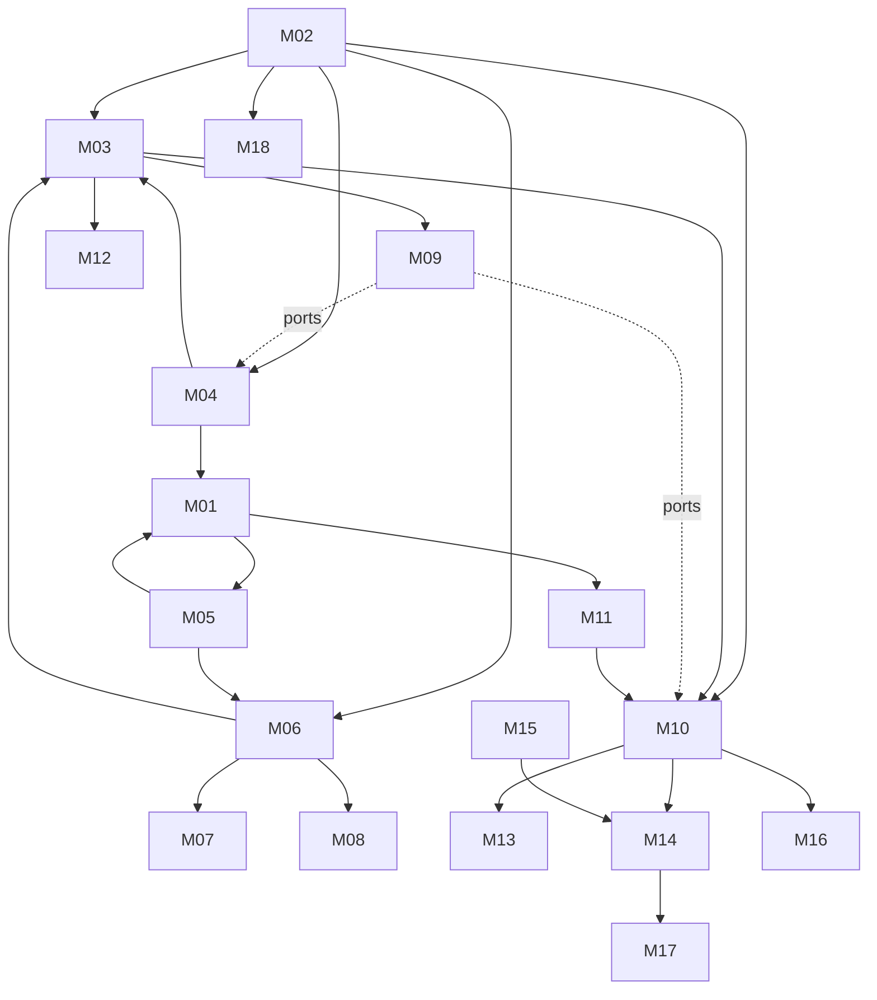

# 11 — Modules

> Part of the Shardrail architecture plan. Status: **candidate, not owner-approved**. Module outlines are the starting point for detailed (Level 2) planning; they are not specifications.

## 1. Module table (authoritative; the graph below is derived from it)

| ID | Module | Responsibilities | Excludes | Depends on | Security boundary |
| --- | --- | --- | --- | --- | --- |
| M01 | Daemon core & lifecycle | startup/shutdown, single-instance lock, data dir, config, health, diagnostics | protocols, client auth | M02, M04, M05 | process owner; data dir `0700` |
| M02 | Contracts & schemas | journal event schema, normalized provider events, wire types, codegen | runtime logic | — | validation at every boundary |
| M03 | Session engine | state machine, delta coalescing, projections, replay handling, command router | storage I/O, spawning | M02, M04, M06 | trusts only normalized events |
| M04 | Journal store | SQLite WAL, epoch, versioning, retention, purge, salvage; implements `ApprovalStore` | business rules | M02 | sensitive store |
| M05 | Provider supervisor | spawn per topology, containment (cgroup / macOS helper), env sanitization, identity records, version detection | protocol semantics | M01 | TB-1, TB-6 |
| M06 | Adapter framework + ACP client | capability negotiation, compatibility classes, normalization, option classification, refusal of unknown requests, replay rules, history read-through | UI, secrets | M02, M05 | never declares client fs/terminal |
| M07 | Codex adapter | thread/turn/item mapping, approvals, background terminals, schema reference, pinning | `thread/shellCommand` in UI, experimental API | M06 | TB-1 |
| M08 | Claude channel | adapter or SDK supervisor; trust settings; branding | product builds until U9 | M06 | terms gate |
| M09 | Approval broker & policy | approval records, option classes, expiry, re-confirmation, host protection state, trust, policy gating; owns `ApprovalStore` and `NotificationSink` ports | judging commands by text | M03 (events), ports | primary safety invariant |
| M10 | Client gateway | transports, handshake, keys, scopes, pairing (P2), fan-out, backpressure, resync, presence; implements `NotificationSink` | domain semantics | M02, M03, M09 (via port), M11 | TB-3 |
| M11 | Workspace service | trust state storage, tree, safe Git worker, watchers, write lease | file writes | M01 | TB-4 |
| M12 | Handoff | bundle assembly, preview, redaction; later Task model | provider memory transfer | M03, M04 | redaction |
| M13 | Desktop shell | window, menu bar, notifications, keychain, deep links (no actions), connect-first, SSH bridge launcher | domain logic | M10 | keychain ACL |
| M14 | Web UI | inbox, session view, workspace pane, palette, host federation | source of truth | M10, M15 | untrusted rendering |
| M15 | UI system & rendering | tokens, primitives, accessibility, incremental Markdown, virtualization, safe rendering | product flows | — | TB-2 |
| M16 | Remote host & bridge | systemd unit, `bridge` subcommand, cgroups, linger, reboot behavior | network listeners | M01, M10 | TB-5 |
| M17 | Mobile client | per D28 | everything until U4 | M10, M14 | `limited` scope |
| M18 | Verification harness | fake agents, fixtures, contract tests, fault injection, perf/soak harness | product features | M02 | fixtures hold no real secrets |

Ports break the earlier dependency cycles: the approval broker defines `ApprovalStore` (implemented by the journal) and `NotificationSink` (implemented by the gateway).

## 2. Outlines of the foundational modules

### M01 + M05 — Daemon core and provider supervision
- **Startup:** lock → open journal (salvage path if corrupt) → resolve recorded provider processes (05 §1 restart rows) → mark sessions → start listener → ready.
- **Shutdown:** protocol cancel → grace → terminate tracked processes (05 §1 escalation); "keep running" only in launch-agent mode.
- **Supervision record:** pid, start time, boot id, cgroup/helper id, binary path, version, compatibility class, sessions hosted; footprint sampled on demand only.
- **Rules:** no auto-restart of providers; one dedicated spawner thread; spawn intent journaled first; environment allowlist minus Shardrail variables and agent sockets.
- **Open:** separate agent user mechanism (U11); per-provider grace periods (S1–S4); network-filesystem data dirs (refuse or warn).

### M03 + M04 — Session engine and journal
- **Write path:** adapter event → validate → update state → ephemeral: buffer + coalesced flush; durable: single-writer batch commit → publish with `event_id` (never publish before commit).
- **Invariants:** strictly increasing `event_id` within an epoch; seen `command_id` never re-executes; intent journaled before dispatch; replay never merged (03 §4); short readers.
- **Failure modes:** crash between accept and dispatch; crash mid-item; disk full (pause new turns); corruption (salvage); cursor from another epoch (resync).
- **Open:** checkpoint interval vs B15; persisted vs recomputed projections (B7); retention defaults.

### M06/M07/M08 — Adapters
- Contract and policies in 03. **Invariants:** no method without capability; missing/malformed/timed-out approval exchanges never become allow; unknown requests refused; unknown messages become notices.
- **Failure modes:** binary replaced on disk mid-session; schema divergence; provider waiting for an approval answer after a Shardrail restart; oversized lines.
- **Open:** normalized shape for sub-agent activity; cost normalization; vendor extensions as capabilities.

### M09 — Approval broker
- Records and transitions in 05 §4; protection model in 06 §3; card contract in 06 §5.
- **Invariants:** allow requires an authorized human action; expiry, error, replay, restart and disconnect never allow; one resolution per approval; policy-weakening and widening/boundary-breaking only with `full`.
- **Open:** default expiry (U10), hold maximum (U17), protection-claim threshold (U21).

### M10 — Client gateway
- **Handshake:** client hello (protocol range, key proof) ↔ server hello (host id, version, scopes, cursor, `journal_epoch`), mutual and transcript-bound.
- **Requests** `{command_id, kind, preconditions?, payload}` → `{command_id, outcome | typed error with current state}`; subscriptions per session or host; `resync_required` with snapshot on gaps.
- **Backpressure:** drop pending ephemeral updates first; if durable backlog still exceeds the bound, end the subscription with `resync_required`; the engine never blocks on a client.
- **Open:** browser credential storage; whether a local `shardrail` CLI exists in Phase 1; one connection per host (recommended).
