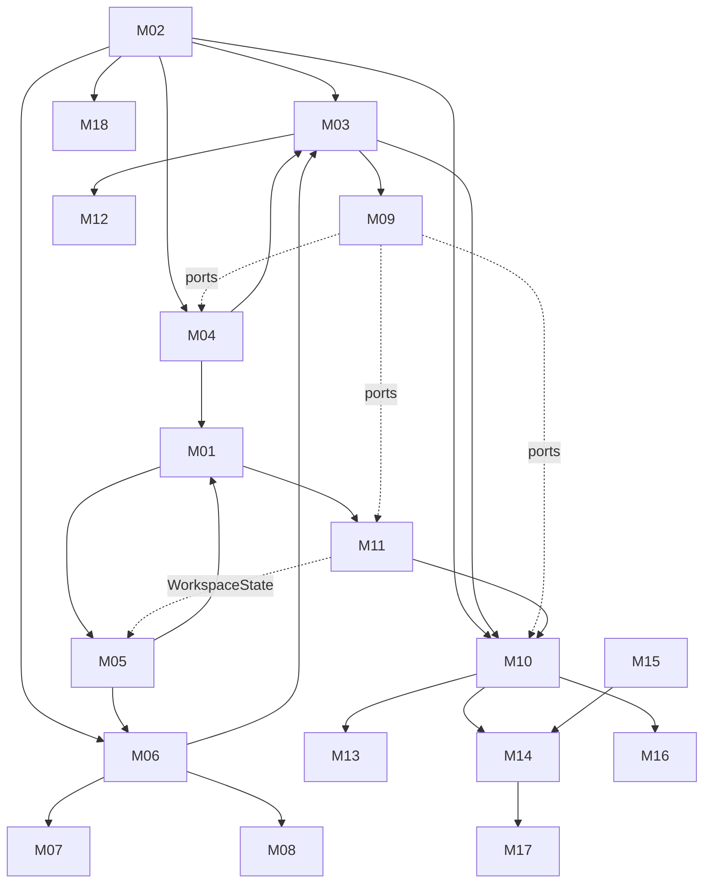

# 11 — Modules
> 2026-10-20 (owner): D49–D54 recorded — React retained on partial S5 evidence; journal opens atomically without following symlinks; daemon refuses network/synced data filesystems; Codex is first in P1a; tokio/clap/nix are allowed daemon dependencies; contracts remain generated with client helpers in `packages/client`.
> 2026-10-23 (owner, D66): M14 is the primary Phase 1 client; M13 Tauri shell is deferred to a later desktop port; M10 loopback listener/pairing moves into Phase 1.

> Part of the Shardrail architecture plan. Status: **candidate, not owner-approved**. Module outlines are the starting point for detailed (Level 2) planning; they are not specifications. Revised 2026-10-18 after the independent review ([15](15-independent-review.md)): ACP dual-stack in M06, `WorkspaceState` port, drain coordination, macOS containment technique. Implementation language for daemon modules: Rust (D1, owner-approved 2026-10-18); Go and C#/.NET were rejected. 2026-10-18 (owner): U8 answered — React 19 + TS strict + Vite SPA + React Aria + TanStack Virtual (D3); all code is written by AI coding agents (D44); §3 engineering rules for AI agents added. 2026-10-19 (owner): D27 approved — Rust types → `schemars` JSON Schema (committed) → TypeScript, `ts-rs` fallback, CI drift check. 2026-10-19: M08 terms gate replaced by D29/D45. 2026-10-19 (owner): U21 answered — v1 never shows a 'protected' status; each session shows a verification checklist (D47); S7 gates any future 'protected' status, which needs a separate decision. 2026-10-19 (owner): remaining owner questions answered in bulk (17); Hermes not in Phase 1 (D48); core spikes S1-lite, S2, S5, S9-lite authorized.

## 1. Module table (authoritative; the graph below is derived from it)

| ID | Module | Responsibilities | Excludes | Depends on | Security boundary |
| --- | --- | --- | --- | --- | --- |
| M01 | Daemon core & lifecycle | `shardraild` binary and CLI; startup/shutdown, single-instance lock, data dir and local-filesystem check, config, health, diagnostics, Unix socket listener | provider protocols, client auth | M02, M04, M05 | process owner; data dir `0700`; socket `0600` |
| M02 | Contracts & schemas | journal event schema, normalized provider events, wire types, codegen (Rust types → committed `schemars` JSON Schema → generated `packages/contracts` DTOs, `ts-rs` fallback, CI drift check; D27); client transport helpers in `packages/client` (D54) | runtime logic | — | validation at every boundary |
| M03 | Session engine | state machine incl. instruction queue and session lifecycle (05 §5a, §9), delta coalescing, projections, replay handling, command router, drain coordination (D39) | storage I/O, spawning | M02, M04, M06 | trusts only normalized events |
| M04 | Journal store | SQLite WAL, epoch, versioning, retention, purge, salvage; implements `ApprovalStore` | business rules | M02 | sensitive store |
| M05 | Provider supervisor | spawn per topology, containment (cgroup / macOS helper), env sanitization, identity records, version detection | protocol semantics | M01 | TB-1, TB-6 |
| M06 | Adapter framework + ACP client | ACP v1/v2 dual-stack (D35), capability negotiation, protocol-fingerprint compatibility classes, normalization, option classification, config-option pinning and policy events, refusal of unknown requests, replay rules, history read-through | UI, secrets | M02, M05 | never declares client fs/terminal (v1) |
| M07 | Codex adapter | thread/turn/item mapping, approvals, background terminals, schema reference, pinning | `thread/shellCommand` in UI, experimental API | M06 | TB-1 |
| M08 | Claude channel | adapter or SDK supervisor; trust settings; branding; user-supplied API key only (D29) | claude.ai login, token collection/brokering | M06 | credentials stay with the provider SDK |
| M09 | Approval broker & policy | approval records with write-ahead responses (D34), option classes, expiry, re-confirmation, host protection state (internal), verification checklist (D47), trust, policy gating, provider bypass table (06 §3a); owns `ApprovalStore`, `NotificationSink` and reads `WorkspaceState` ports | judging commands by text | M03 (events), ports | primary safety invariant |
| M10 | Client gateway | transports, handshake, keys, scopes, Phase 1 loopback browser listener and pairing, fan-out, backpressure, resync, presence; implements `NotificationSink` | domain semantics | M02, M03, M09 (via port), M11 | TB-3, TB-7 |
| M11 | Workspace service | trust state storage, tree, safe Git worker (Phase 1e), watchers, write lease; implements `WorkspaceState` (trust, HEAD, diff hash) for M09 and M05 | file writes | M01 | TB-4 |
| M12 | Handoff | bundle assembly, preview, redaction; later Task model | provider memory transfer | M03, M04 | redaction |
| M13 | Desktop shell (deferred port) | Tauri window, menu bar, notifications, keychain, deep links (no actions), shell-minted token, WebView isolation, connect-first, SSH bridge launcher | domain logic | M10 | keychain ACL; Tauri isolation |
| M14 | Primary Phase 1 Web UI | browser pairing, inbox, session view, workspace pane, palette; later host federation | source of truth | M10, M15 | untrusted rendering; browser credential storage |
| M15 | UI system & rendering | tokens, React Aria–based primitives, accessibility, streaming Markdown via one `untrusted-render` module, TanStack virtualization, safe rendering (08 §6) | product flows | — | TB-2 |
| M16 | Remote host & bridge | systemd unit, `bridge` subcommand, cgroups, linger, reboot behavior | network listeners | M01, M10 | TB-5 |
| M17 | Mobile client | per D28 | everything until Phase 3 (U4 deferred) | M10, M14 | `limited` scope |
| M18 | Verification harness | fake agents, fixtures, contract tests, fault injection, perf/soak harness | product features | M02 | fixtures hold no real secrets |

Ports break the earlier dependency cycles: the approval broker defines `ApprovalStore` (implemented by the journal), `NotificationSink` (implemented by the gateway) and `WorkspaceState` (implemented by the workspace service; also read by the supervisor to choose trust-dependent launch options such as Claude `settingSources`). Edge added 2026-10-18 (15 S12).

## 2. Outlines of the foundational modules

### M01 daemon binary skeleton (T1.3a)
- **Task:** build the `shardraild` binary with CLI options for the data directory and Unix socket path; use the allowlisted `tokio`, `clap`, and `nix` crates (D53).
- **Acceptance:** acquire the single-instance lock; refuse network or synced filesystems (D51); atomically open/create the journal relative to the data-directory descriptor without following symlinks (D50); recover the journal exactly once before listening; create the socket with mode `0600` under a mode-`0700` data directory; on SIGTERM/SIGINT stop accepting connections, remove the socket, and release the lock. Startup and refusal paths have deterministic fixtures.

### M01 + M05 — Daemon core and provider supervision
- **Binary:** `shardraild` is the single daemon entry point. Its CLI accepts data-directory and socket paths; Tokio runs the Unix socket listener and signal handling, Clap parses CLI arguments, and nix supplies reviewed Unix operations (D53).
- **Startup:** acquire the data-directory lock → refuse a network or synced filesystem (D51) → open/create the journal atomically without following symlinks using the data-directory descriptor (D50) → recover the journal once → resolve recorded provider processes (05 §1 restart rows) → mark sessions → start the Unix socket listener → ready. The socket is created in the `0700` data directory with mode `0600`.
- **Shutdown:** protocol cancel → grace → terminate tracked processes (05 §1 escalation); "keep running" only in launch-agent mode.
- **Supervision record:** pid, start time, boot id, cgroup/helper id, binary path, version, compatibility class, sessions hosted; footprint sampled on demand only.
- **Rules:** no auto-restart of providers; one dedicated spawner thread; spawn intent journaled first; environment allowlist minus Shardrail variables and agent sockets.
- **Planned restart:** drain-then-upgrade (D39, 05 §1).
- **macOS containment helper:** process group + `NOTE_FORK`/`p_puniqueid` scan + inherited sentinel fd (D43, 06 §8).
- **Open:** separate agent user mechanism (U11, deferred to Phase 2); per-provider grace periods (S1–S4). Network or synced filesystem data dirs are refused (D51).

### M03 + M04 — Session engine and journal
- **Write path:** adapter event → validate → update state → ephemeral: buffer + coalesced flush; durable: single-writer batch commit → publish with `event_id` (never publish before commit). M04 opens/creates the journal atomically relative to the data-directory descriptor without following symlinks (D50), before real providers are connected.
- **Invariants:** strictly increasing `event_id` within an epoch; seen `command_id` never re-executes; intent journaled before dispatch; replay never merged (03 §4); short readers.
- **Failure modes:** crash between accept and dispatch; crash between approval write and commit (prevented by D34); crash mid-item; disk full and corruption (fail closed, 05 §10, D41); cursor from another epoch (resync); queued instruction across restart (05 §5a).
- **Open:** checkpoint interval vs B15; persisted vs recomputed projections (B7); retention defaults.

### M06/M07/M08 — Adapters
- Contract and policies in 03. **Invariants:** no method without capability; missing/malformed/timed-out approval exchanges never become allow; unknown requests refused; unknown messages become notices.
- **Failure modes:** binary replaced on disk mid-session; schema divergence; provider waiting for an approval answer after a Shardrail restart; oversized lines.
- **Open:** normalized shape for sub-agent activity; cost normalization; vendor extensions as capabilities.

### M09 — Approval broker
- Records and transitions in 05 §4; protection model in 06 §3; card contract in 06 §5.
- **Invariants:** allow requires an authorized human action; expiry, error, replay, restart and disconnect never allow; one resolution per approval; response journaled before it is sent (D34); policy-weakening and widening/boundary-breaking only with `full`; agent-initiated mode changes are policy events (06 §3a).
- **Settled (owner 2026-10-19):** default expiry 180 s or lower provider limit (U10), hold maximum 2 h with 15-min re-confirmation (U17). U21 answered: no "protected" status in v1; M09 computes the per-session verification checklist (06 §3b, D47).

### M10 — Client gateway
- **Handshake:** client hello (protocol range, key proof) ↔ server hello (host id, version, scopes, cursor, `journal_epoch`), mutual and transcript-bound.
- **Requests** `{command_id, kind, preconditions?, payload}` → `{command_id, outcome | typed error with current state}`; subscriptions per session or host; `resync_required` with snapshot on gaps.
- **Backpressure:** drop pending ephemeral updates first; if durable backlog still exceeds the bound, end the subscription with `resync_required`; the engine never blocks on a client.
- **Phase 1:** opt-in loopback WebSocket and browser pairing. Browser clients default to `limited`; a separate explicit local authorization is required for `full`. Use non-extractable WebCrypto Ed25519 keys in IndexedDB when supported; otherwise disclose the extractable `@noble/ed25519` IndexedDB fallback in the pairing UI. Host and Origin checks happen before upgrade/authentication; credentials never appear in URLs.
- **Open:** whether a local `shardrail` CLI exists beyond the local pairing/authorization flow; one connection per host (recommended).

## 3. Engineering rules for AI agents (all modules; D44)

All code is written by AI coding agents. These rules make errors visible to machines rather than to a human reviewer. UI-specific rules are in 08 §6.

1. **Pins and context.** Exact versions in `Cargo.lock`/lockfiles; an `AGENTS.md` at the repository root with a "dependency → version → llms.txt/MCP/docs link" table; agents consult those sources instead of memory (R45).
2. **Dependencies only through an ADR.** Agents never add a crate or package on their own; an allowlist lives in the repository; CI runs `cargo-deny`, `npm audit signatures` and license checks (06 §12).
3. **Types are the first gate.** Rust: `#![deny(unsafe_code)]` outside reviewed modules, Clippy (default plus a selected set of pedantic lints) with `-D warnings` in CI. TypeScript: `strict`, `noUncheckedIndexedAccess`, `exactOptionalPropertyTypes`; no `any`, `as unknown as`, `@ts-ignore`. Generated contract types (D27) are never hand-edited.
4. **CI is the merge gate.** Format, lint, type check, unit/contract tests (fake agents, M18), and the relevant budget harness must pass; nothing merges red.
5. **Fixtures over mocks.** Protocol behaviour is tested with fake agents and recorded fixtures, never hand-written mocks of provider protocols.
6. **Cross-family review.** Every agent-authored change is reviewed by an agent from a different model family, with a checklist (approval invariants, untrusted text, accessibility, re-renders, journal-before-send).
7. **No pre-1.0 or RC frameworks** in the product without an ADR (16 §1).
8. **Freshness.** Once per phase an agent re-checks versions and breaking changes against changelogs and llms.txt, updates `AGENTS.md` and records the date (as in 14).
